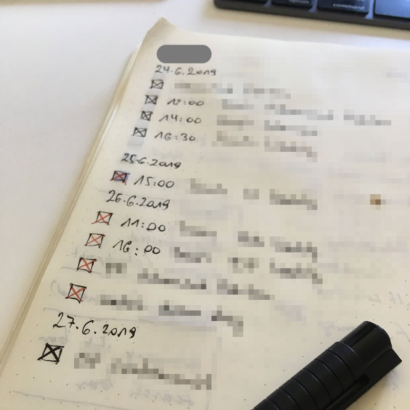
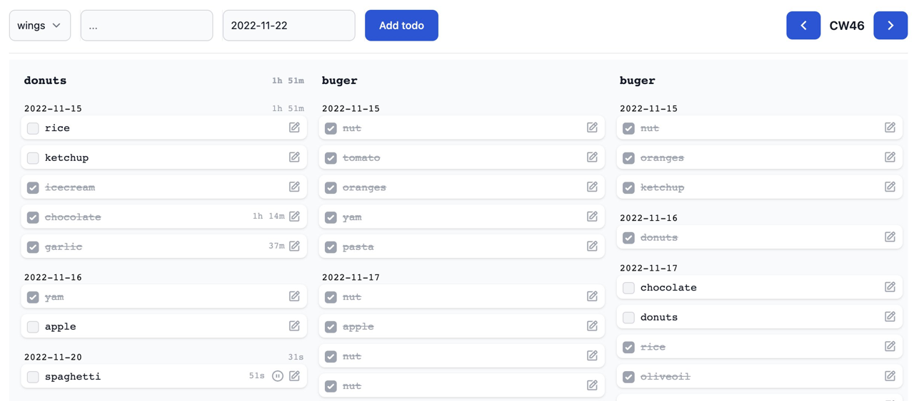

# Eddo

_GTD-inspired todo & time tracking with AI integration_

<p align="center">
  
  
</p>

📺 [Watch the sneak peek intro on YouTube](https://www.youtube.com/watch?v=jiWS9pP_cX0)<br>
📺 [Setup walkthrough & pi-coding-agent demo](https://www.youtube.com/watch?v=jQH693-T5NQ)

**⚠️ Alpha Software**: This is a solo side project under active development. Feel free to try it and provide feedback, but expect rough edges, breaking changes, and don't rely on data integrity across updates.

## Overview

Eddo is a personal project that combines classic GTD (Getting Things Done) methodology with modern AI capabilities. Born from a notebook-based system refined over 10+ years, it's my attempt to digitize that workflow while exploring what's possible with AI assistants.

Manage todos through a web interface, Telegram bot with Claude AI, or programmatically via MCP. Includes [pi-coding-agent](https://buildwithpi.ai) integration with custom skills and extensions for AI-assisted development workflows.

|                         Inspiration                         |                     Eddo (initial 2022 verrsion)                      |
| :---------------------------------------------------------: | :-------------------------------------------------------------------: |
|  |  |

### Features

- **GTD Contexts** — Organize todos by context (work, home, projects) in Kanban columns
- **Calendar Week View** — Navigate todos by week with date-range queries
- **Dependency Graph** — Open focused parent/child + blockedBy graph from table row actions with Graphviz leveling
- **Time Tracking** — Start/pause timers with daily summaries and filter views by active tracking state
- **Offline-First** — PouchDB local storage with real-time sync
- **AI Agent** — Telegram bot with Claude for natural language todo management
- **GitHub Sync** — Auto-import issues assigned to you
- **RSS Feeds** — Subscribe to feeds, create todos from items
- **Email Sync** — Gmail OAuth integration for email-to-todo
- **MCP Server** — Programmatic access via Model Context Protocol
- **pi-coding-agent Skills** — AI coding assistant integration

### Scheduled Telegram reports

Briefings and recaps reserve each user's local date and configured report time in CouchDB before generation.
Reservations prevent duplicate runs across overlapping checks and bot restarts. The scheduler alone delivers and prints reports.
Confirmed generation failures release the reservation for retry. Delivery errors retain it because Telegram may have accepted the message.
A process crash after reservation can skip that report. Change its configured time to schedule another attempt that day.
Reservations use server-local CouchDB documents; database replication and backups do not preserve them.

## Quick Start

**Requirements**: Node.js ≥24.0.0, pnpm ≥7.1.0, Docker

```bash
# Clone repository
git clone https://github.com/walterra/eddoapp.git
cd eddoapp

# Optional: Use latest stable release instead of main branch
git checkout $(git describe --tags --abbrev=0)

# Install dependencies
pnpm install

# Run interactive setup wizard
pnpm dev:setup

# Start development server
pnpm dev

# Open http://localhost:3000
```

### What Setup Does

The `pnpm dev:setup` wizard:

1. **Checks prerequisites** — Node.js, pnpm, Docker, Git
2. **Starts Docker services** — CouchDB and Elasticsearch
3. **Generates `.env`** — Development defaults
4. **Builds packages** — Core libraries and setup tools
5. **Creates user** — `eddo_pi_agent` for MCP/agent access
6. **Links pi-coding-agent skills** — If pi is installed globally

### Troubleshooting

```bash
pnpm dev:doctor
```

Diagnoses: prerequisites, Docker status, service health, port availability, configuration.

### Code Quality

```bash
pnpm check:commit
```

Runs the TypeScript build first, then checks backup script types, ESLint, and Prettier in parallel.

## Architecture

Monorepo with these packages:

| Package        | Description                                     |
| -------------- | ----------------------------------------------- |
| `web-client`   | React frontend with PouchDB offline storage     |
| `web-api`      | Hono API server, CouchDB proxy, sync schedulers |
| `core-shared`  | Shared types, utilities, data models            |
| `core-server`  | Server-side database and config                 |
| `core-client`  | Client-side config                              |
| `mcp-server`   | Model Context Protocol server                   |
| `telegram-bot` | AI bot with Claude integration                  |
| `setup`        | Setup wizard and doctor tools                   |
| `chat-agent`   | Skills and extensions for pi-coding-agent       |

### Data Flow

```
Browser (PouchDB) ←→ Web API ←→ CouchDB
                         ↓
                  Elasticsearch (search)

Telegram Bot → MCP Server → CouchDB
```

## Integrations

### Telegram Bot

AI-powered assistant for natural language todo management:

```
"Add a work todo for tomorrow's meeting"
"What's overdue?"
"Start tracking time on the API refactor"
```

**Setup**: Set `TELEGRAM_BOT_TOKEN` and LLM provider key (for example `ANTHROPIC_API_KEY` or `OPENAI_API_KEY`) in `.env`

```bash
pnpm dev:telegram-bot
```

Features:

- Multi-step instruction handling
- Daily briefings at scheduled times
- GitHub/RSS/Email sync configuration via bot commands

#### Experimental durable Telegram pilot

Opt individual Eddo usernames into restartable interactive agent execution:

```bash
TELEGRAM_DURABLE_USERS=alice,bob
TELEGRAM_DURABLE_MODEL=anthropic/claude-sonnet-4-5
```

Leave `TELEGRAM_DURABLE_USERS` empty to retain the existing agent for everyone. Restart the bot after configuration changes.
Configure the selected provider's API key. The legacy `LLM_MODEL` remains separate for other users and scheduled reports.

The pilot uses Pi Durable 1.3.0 and `pi-durable-couchdb` 0.0.1. It supports linked private Telegram chats only.
The bot provisions an administrator-only `${DATABASE_PREFIX}_pi_durable_<username-sha256>` database for each enrolled user.
CouchDB credentials must permit database creation, security configuration, and runtime journal access. Use TLS outside local development.
Run **exactly one bot process** against these databases. No distributed lock or automatic ownership failover exists.

Accepted updates, model/tool state, and pending replies survive process restarts.
Startup recovers enrolled users; failed storage sessions reopen on a 30-second recovery cycle.
Completed exchanges project into the existing assistant chat database with stable message IDs.
`/new` selects a separate durable conversation through the existing active-conversation mechanism.
The first durable conversation starts without importing legacy history. Existing history stays available in the application.
Scheduled briefings and recaps continue using the existing agent and reservation flow.

Safety boundaries:

- Duplicate Telegram updates reuse their stored request, including after `/new` or a restart.
- Durable failures never retry the request through the legacy agent.
- Read tools allow replay. Interrupted mutations return an unknown-outcome error instead of replaying automatically.
- Authorization and MCP credentials refresh before resumed actions; revoked or unlinked users cannot invoke tools.
- Journals bind to one Telegram identity. Relinking the Eddo account to another Telegram ID blocks recovery pending operator review.
- Runs allow 50 tool executions and a five-minute deadline, including downtime. In-flight external actions may finish after cancellation.
- Failed projection/delivery retries every 30 seconds. The Telegram handler stops waiting after six minutes; durable delivery continues.
- Ambiguous Telegram sends can produce duplicate reply chunks.
- Entire journal history loads into memory. Context compaction reduces model context, not stored history or memory growth.

Back up each runtime database as a complete authoritative copy. Default `eddo_*` backups include default-prefix runtime databases.
Do not delete journal/head documents, apply TTL retention, or restore incomplete replicated copies.
To roll back, stop the bot, empty the enrollment list, then restart. Pending durable work remains paused until re-enrollment.
Keep the runtime databases for recovery; the existing agent does not resume their pending work.

Run pilot tests from the repository root:

```bash
pnpm vitest:run packages/telegram_bot/src/durable
pnpm test:integration:durable # Disposable CouchDB 3.5 container; Docker required, no model API calls
```

### GitHub Issue Sync

Sync issues assigned to you into Eddo todos:

1. Create PAT at https://github.com/settings/tokens (scope: `repo` or `public_repo`)
2. Configure: `/github token ghp_your_token`
3. Enable: `/github on`
4. Check: `/github status`

Each repository becomes its own context. Issues auto-complete when closed on GitHub.

### RSS Feed Sync

Subscribe to RSS/Atom feeds:

1. Add feed: `/rss add https://example.com/feed.xml`
2. Enable: `/rss on`
3. List feeds: `/rss list`

Supports autodiscovery — add a website URL and Eddo finds the feed.

### Email Sync (Gmail)

Sync emails from a designated folder to todos:

1. Start OAuth: `/email auth`
2. Authorize in browser
3. Enable: `/email on`
4. Set folder: `/email folder Eddo`

Requires Google Cloud project setup. See [Gmail OAuth Setup](docs/gmail-oauth-setup.md).

### MCP Server

Programmatic todo access via Model Context Protocol:

```bash
pnpm dev:mcp-server
pnpm test:mcp-server  # Interactive testing
```

> **Note**: MCP requests require an API key via `Authorization: Bearer <key>` or `X-API-Key`. Generate the API key in User Profile → Security or from `pnpm dev:create-user` output. Don't expose the MCP server to untrusted networks.

### pi-coding-agent Integration

If you use [pi-coding-agent](https://github.com/mariozechner/pi-coding-agent), Eddo provides skills and extensions:

**Skills:**

- `eddo-todo` — Task management commands
- `eddo-work` — Structured implementation workflow
- `eddo-spawn` — Multi-agent git worktree orchestration
- `elasticsearch-esql` — ES|QL query generation
- `searxng-search` — Web search integration

**Extensions:**

- `graphviz-chart` — Diagram rendering
- `vega-chart` — Data visualization

The setup wizard auto-links these if pi is installed globally (`npm i -g @mariozechner/pi-coding-agent`).

## Backup & Recovery

```bash
# Interactive backup/restore
pnpm backup:interactive
pnpm restore:interactive

# Full CouchDB server backup, including system databases; preserve existing backups
pnpm backup:auto --all-databases --run-once --no-retention

# Scheduled application backups (default scope: eddo_*)
pnpm backup:auto

# Verify an archive and its matching metadata sidecar
pnpm backup:verify backups/<database>-<timestamp>.json

# Retention policy
pnpm backup:retention
```

Backups include attachment bodies and a matching `.json.metadata.json` sidecar with security settings,
SHA-256 checksum, and source document revisions. Keep both files together. Restore validates the archive
before replacing a database, decodes UTF-8 safely, and reapplies security settings. Legacy archives remain
supported when documents use array batches and any header occupies physical line one; individual-document
NDJSON is rejected before replacement. Missing attachment bodies fail validation, and missing metadata limits
recovery verification. Source and restored inventories verify winning live revisions only, not losing conflict
leaves or tombstones independently.

Archive creation rejects concurrent source changes and leaves incomplete files as `.partial`. Retry during
an idle period. Published archives have private file permissions; retention removes their sidecars too.
Full-server scope overrides `--pattern` and includes system databases. Discovery, backup, and verification
failures return a nonzero exit status in one-shot mode; zero matches also fail.

These are logical CouchDB backups, not cross-database atomic snapshots. They exclude server/admin
configuration, `_local` documents, unsynced browser data, and other services. Store configuration backups
and encrypted off-host copies separately. Attachment support uses couchbackup's experimental CouchDB-only
option; do not use these tools against IBM Cloudant.

Run `pnpm test:backup` for regression tests and `pnpm test:integration:backup` for disposable CouchDB
round-trip tests (Docker required; production databases are never selected).

See [Disaster Recovery Guide](docs/07_disaster-recovery.md).

## Development

```bash
pnpm dev              # Start all services
pnpm test             # Run tests
pnpm lint             # Check code style
pnpm build            # Production build
pnpm dev:create-user  # Create user manually
```

See [DEVELOPMENT.md](DEVELOPMENT.md) for architecture details, testing, and contribution guidelines.

### Day-paging performance benchmark

Run a reproducible synthetic workload against an isolated CouchDB container with a visible browser:

```bash
pnpm benchmark:profile-reference walterra
pnpm build:web-client
pnpm benchmark:day-paging --headed --months 3
pnpm benchmark:background-writes --headed --steps 6
```

Requires Docker and `agent-browser` with Chromium installed. Profiles the configured account read-only, then generates synthetic data.
Produces kanban/table HTML, JSON, and CSV timing reports with live replication progress.
Background-write scenarios compare controls against concurrent updates and RSS-style ingestion using disposable databases.
See [benchmark documentation](scripts/benchmarks/README.md) for profiles, measurement boundaries, and headless runs.
See [Synology telemetry setup](spec/synology_telemetry.md) for authenticated Collector forwarding and opt-in benchmark traces.

## License

MIT
